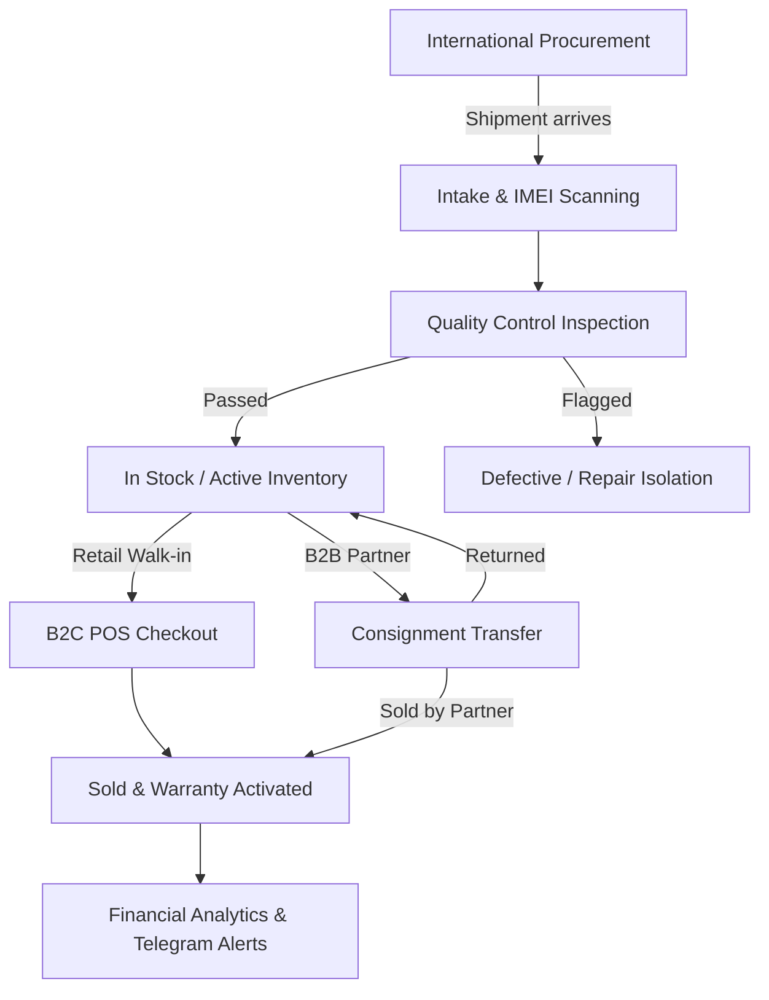

# Product Requirements Document (PRD)
## Mobile Retail ERP & POS System (Malika Bazaar)

---

### 1. Executive Summary & Project Overview

This Product Requirements Document (PRD) defines the functional, operational, and technical specifications for a custom-built, local-first Enterprise Resource Planning (ERP) and Point-of-Sale (POS) system designed for a mobile device retail store operating in the **Malika Bazaar** electronics market in Tashkent.

The system streamlines end-to-end device lifecycle tracking—from international batch procurement (primarily from South Korea) and quality control to B2C retail sales, B2B partner consignments, financial reporting, and automated Telegram bot notifications.

#### Project Specifications

| Parameter | Specification | Details |
| :--- | :--- | :--- |
| **Deployment Model** | Single-client custom build | Non-SaaS, single-tenant deployment tailored to store operations. |
| **Platform** | Desktop-first web application | Optimized for rapid barcode/IMEI scanner workflows across multiple terminals. |
| **Connectivity** | Local-First ("Offline-First") | Automatic background synchronization to a central server upon internet restoration. |
| **Currency Policy** | Single-currency tracking | Multi-currency conversion and exchange rate management are explicitly excluded from scope. |

---

### 2. User Roles & Access Control

The system supports role-based access control (RBAC) across store terminals. Roles and permissions are **data, not code**: the three roles below are seeded defaults, each mapping to a set of fine-grained permissions (`<resource>.<action>`), and the Admin can create roles, edit a role's permissions, or grant/revoke individual permissions per user (e.g. a Cashier granted `device.cost.view`). See ADR 0003.

Default roles:

* **Store Owner (Admin)**
  * Full access to all system modules.
  * Procurement landed-cost calculations and unit acquisition prices.
  * Net profit margins and financial reporting.
  * Partner debt ledgers and operational expenses.
  * Telegram bot notification configurations.

* **Store Manager / Cashier (POS Operator)**
  * Inventory lookup and search.
  * B2C POS checkout and warranty verification.
  * B2B consignment transfers.
  * *Restriction:* Restricted from viewing unit acquisition costs and net profit margins unless explicitly granted by the Admin.

* **Inventory / QC Specialist**
  * Incoming shipment logs and batch registration.
  * IMEI intake scanning via barcode scanners.
  * Visual and cosmetic quality control (QC) grading.

---

### 3. End-to-End Business Workflows

#### Detailed Workflow Stages

1. **Procurement & Intake**:
   * Store orders a batch of devices from international suppliers (e.g., South Korea).
   * Staff logs batch shipment and logistics overhead costs.
   * Individual device IMEIs are scanned upon arrival.
   * System automatically computes the landed unit cost.

2. **Quality Control (QC)**:
   * Staff inspects each incoming device.
   * Condition status is marked as **Not Defective** (default) or **Defective** with specific cosmetic/hardware notes.
   * Cleared devices enter active inventory (**In Stock**).

3. **Distribution Channels (B2C or B2B)**:
   * **Retail Sale (B2C)**: Cashier scans IMEI at checkout $\rightarrow$ optionally attaches customer profile $\rightarrow$ logs sale price $\rightarrow$ system deducts stock, activates warranty countdown timer, and logs net profit.
   * **Partner Consignment (B2B)**: Cashier selects partner shop in Malika Bazaar $\rightarrow$ scans IMEI for "One-Tap" transfer $\rightarrow$ device status shifts to **Consigned** $\rightarrow$ partner ledger balance and due date update automatically.

4. **Settlement & Analytics**:
   * Real-time financial dashboard updates cash flow, rolling average model pricing, and net margins.
   * Automated Telegram bot dispatches instant event alerts and end-of-day summaries to the Store Owner.

---

### 4. Core Functional Requirements (Modules)

#### Module 1: Procurement & Quality Control (QC)
* **Purchase Order Registration**:
  * Create incoming shipment batches with supplier details, shipment date, total item count, and logistics/customs overhead costs.
* **Automated Landed Cost Calculation**:
  * Automatically distribute batch shipping/overhead costs across devices in the shipment.
  * Support per-unit acquisition cost entry to establish the true cost basis.
* **QC Inspection Workflow**:
  * **Default State**: Automatically set to `Not Defective` to accelerate high-volume intake.
  * **Defect Flagging**: Toggle option to flag a device as `Defective`, opening structured input fields (e.g., battery health %, screen scratches, FaceID/camera issues, repair cost estimates).
  * **Isolation**: Defective units are isolated from standard sellable stock until repaired or cleared for discounted sale.

#### Module 2: IMEI-Driven Inventory Management
* **Unique IMEI Tracking**:
  * Every device is indexed by its unique 15-digit IMEI.
  * Scanned via USB or Bluetooth barcode scanners, with keyboard HID support, manual fallback, and duplicate-entry prevention.
* **Device Attributes**:
  * Model name, storage capacity, color, battery health, cosmetic grade, acquisition cost, target selling price, current status, and intake date.
* **Lifecycle Statuses**:
  * `In Stock`: Available on the shop floor for immediate sale or consignment.
  * `Defective`: Flagged during QC or returned under warranty; requires servicing/repair.
  * `Consigned`: Temporarily handed over to a partner store in the bazaar ("Nasiya").
  * `Sold`: Completed B2C sale or settled B2B transaction.
* **Fast Search & Filtering**:
  * Instant search and autocomplete by the last 4–6 digits of IMEI, model, storage, or current status.

#### Module 3: B2C Point of Sale (POS) & Warranty Tracking
* **Rapid Checkout Interface**:
  * Instant IMEI scan to auto-populate device specifications into the checkout cart.
* **Flexible Customer CRM**:
  * **Anonymous Checkout**: Process walk-in sales immediately with zero required customer fields.
  * **Profiled Checkout**: Optionally attach customer name and phone number to build purchase history and simplify future warranty claims.
* **Automated Post-Sale Triggers**:
  * Updates device status to `Sold`.
  * Computes exact net profit:
    $$\text{Net Profit} = \text{Final Sale Price} - \text{Landed Acquisition Cost}$$
  * Initiates warranty countdown timer (e.g., 14-day, 30-day, or custom store warranty) tied directly to the IMEI.
* **Warranty & Return Lookup**:
  * Scan a returning customer's IMEI to immediately verify purchase date, remaining warranty days, original sale price, and original intake QC notes.

#### Module 4: B2B Consignment Management ("Nasiya" / Partner Shops)
* **Partner Directory**:
  * Maintain profiles for trusted fellow merchants and shops within Malika Bazaar:
    * Shop Name
    * Contact Person
    * Phone / Telegram handle
    * Credit Limit
* **One-Tap Consignment Transfer**:
  * Select partner $\rightarrow$ scan IMEI(s) $\rightarrow$ enter agreed wholesale/consignment price and payment/return due date.
* **Consignment Resolution States**:
  * **Settled (Paid)**: Partner sells the phone and delivers payment $\rightarrow$ status changes to `Sold`, partner debt decreases, and profit is realized.
  * **Returned to Stock**: Partner returns unsold unit $\rightarrow$ status reverts to `In Stock`, and partner balance adjusts automatically.
* **Partner Ledger & Aging**:
  * Live tracking of total active devices held by each partner, total outstanding balance, partial payments, and overdue alerts.

#### Module 5: Real-Time Financial Analytics & Expense Tracking
* **Profitability Engine**:
  * Real-time calculation of gross revenue, Cost of Goods Sold (COGS), and net profit per device, per model line, and per time period (daily, weekly, monthly).
* **Average Model Pricing Analytics**:
  * Automatically calculates rolling average acquisition costs and average selling prices per specific device model/storage variant (e.g., iPhone 15 Pro 256GB) to guide buying and pricing decisions.
* **Operational Expense Tracker**:
  * Log recurring and ad-hoc shop expenses (booth rent, staff salaries, utilities, accessories, minor repairs) to compute true Net Operating Income.

#### Module 6: Telegram Bot Integration
* **Instant Event Notifications**:
  * Push notifications sent to the Store Owner's private chat or designated admin group:
    * **New Shipment Arrival**: Batch summary from Korea (total units, models, flagged defective count).
    * **Low-Stock Warnings**: Triggered when high-demand models fall below a configurable threshold.
    * **Consignment Activity**: Instant alert when a device is consigned out, payment is received, or a partner's due date expires.
    * **High-Value / Below-Margin Alerts**: Notification if a device is sold below its target price or minimum margin threshold.
* **Daily Closing Digest**:
  * Automated end-of-day summary at shop closing time:
    * Total units sold
    * Gross sales revenue
    * Net profit
    * Operational expenses logged
    * Total outstanding consignment balances ("Nasiya")

#### Module 7: Repairs (Change 13)
* **Optional per-store flag**: `StoreSettings.repairsEnabled` (off by default). While off the module is invisible everywhere (nav, routes, report tab, customer detail) and every `/repairs` route refuses **403 `REPAIRS_DISABLED`**.
* **Ticket**: a per-store sequential number; a customer (id or inline name + phone); free-text phone with optional model / IMEI / serial; problem; agreed price; warranty days typed on the ticket; and exactly one master — the shop's own (`masterUserId`) **XOR** an outside one (name, phone, cost), derived from whichever field is set.
* **Status machine**: `RECEIVED` → `IN_REPAIR` → `READY` → `GIVEN_BACK`, plus terminal `CANCELLED` (both `GIVEN_BACK` and `CANCELLED` are terminal). Illegal moves → **409 `REPAIR_ILLEGAL_MOVE`**; writing to a terminal ticket → **409 `REPAIR_TERMINAL`**; an owed hand-over requires a reason (**409 `REPAIR_BALANCE_OWED`**).
* **Parts**: QUANTITY stock products via `StockService` as a signed `REPAIR_USE` movement (out on add, back in on remove, freezing average cost).
* **Money**: payments, refunds (negative, capped at net paid) and outside-master payments post to the ledger (`REPAIR_PAYMENT` / `REPAIR_OUTSIDE`) in the same transaction, with an open-shift gate when shifts are enabled.
* **Derived figures**: nothing derivable is stored — paid, outstanding, parts cost, profit and the warranty window are computed on read; parts / outside / profit are redacted (null) without `device.cost.view`.
* **Printable ticket, share link & reports tab**: a client-built ticket paper can be printed or shared as a link; a repairs report tab shows income, parts cost, outside cost and profit for a date range.
* **Access & offline**: `repair.read` / `repair.manage` / `repair.payment` are ADMIN-only (cashiers only via explicit user permission overrides). Web writes that fail on transport queue in an offline outbox and replay through server sync handlers; native mobile repairs remain online-only.

---

### 5. Technical Architecture & Non-Functional Requirements

* **Offline-First Capabilities**:
  * Utilizes local browser storage (IndexedDB) paired with a local sync engine / Service Workers so POS checkouts, IMEI lookups, and consignment transfers function with zero latency during bazaar internet outages.
  * Queues mutations locally with timestamps and automatically reconciles with the central cloud database once connectivity is restored.
* **Conflict Resolution**:
  * Strict IMEI state-locking prevents double-selling. If an IMEI is modified offline on two terminals simultaneously, the system flags a conflict prompt for Admin resolution upon sync.
* **Hardware Compatibility**:
  * Standard plug-and-play support for USB and wireless 1D/2D barcode scanners acting as keyboard HID input, plus thermal receipt and label printers.
* **UI/UX & Localization**:
  * High-contrast, keyboard-shortcut-friendly desktop web interface designed for fast operation during peak bazaar hours.
  * Interface localized in natural, practical Uzbek (incorporating standard industry terminology familiar to Malika merchants).
* **Security & Backups**:
  * Daily automated encrypted database backups to prevent inventory or ledger loss.
